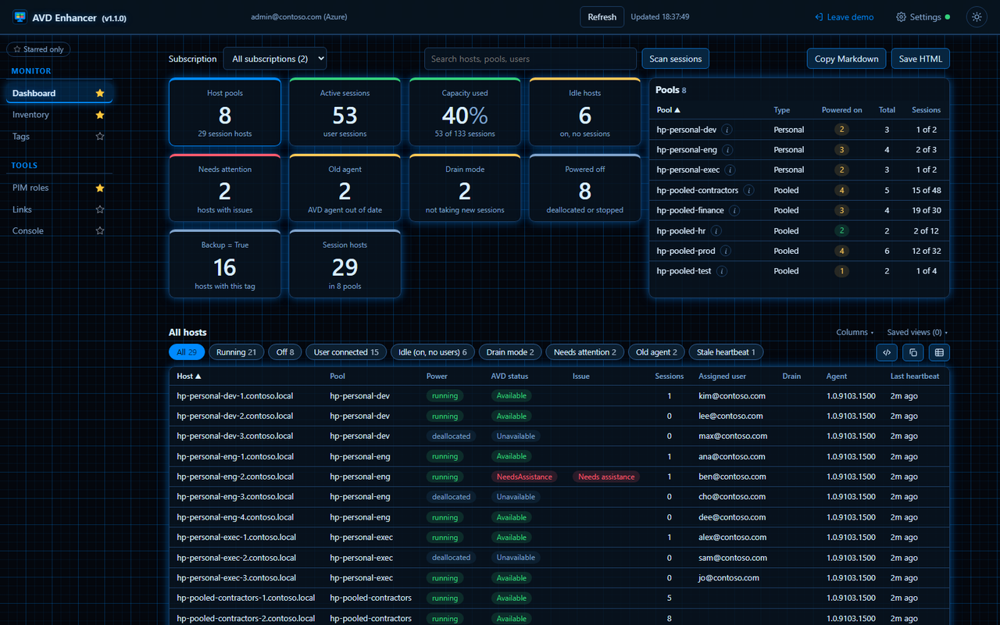
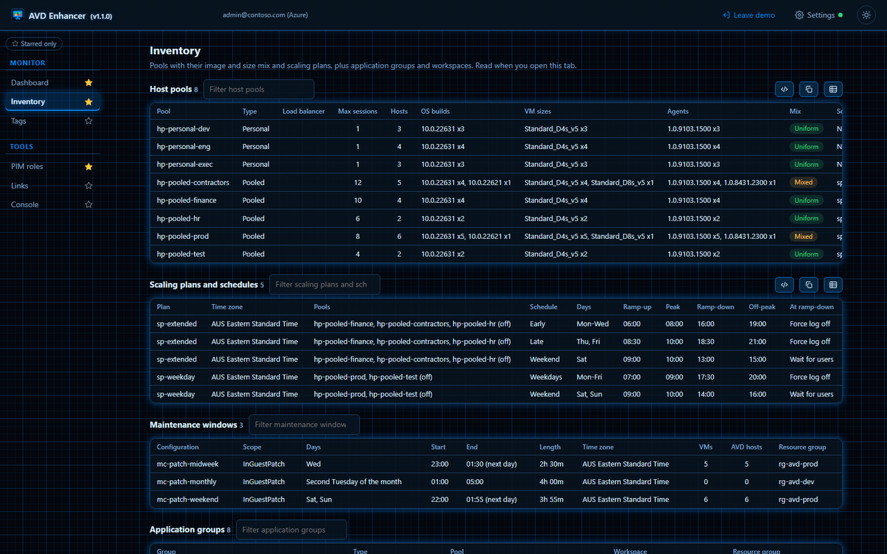
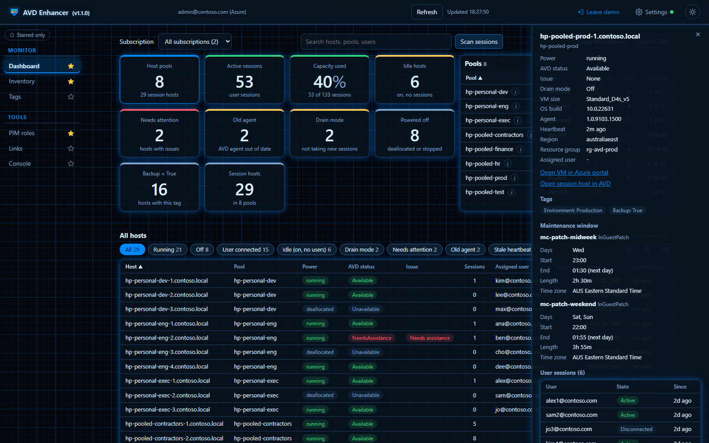

> I have spent many, many hours creating and testing this. If it helps you please consider buying me a Coffee :)

# AVD Enhancer

A control panel for Azure Virtual Desktop in your browser. See your host pools, session hosts, power state and user sessions at a glance, spot idle hosts and out-of-date agents, and check scaling plans, maintenance windows, tags and your PIM roles, without clicking through the Azure portal. Read-only. It talks only to Azure, and no data goes to the developer.

Works in Google Chrome, Microsoft Edge and Mozilla Firefox. Find it by searching for **AVD Enhancer** in the Chrome Web Store, Microsoft Edge Add-ons or Firefox Add-ons.

## What it shows

- **Dashboard:** eight tiles (host pools, active sessions, capacity used, idle hosts, needs attention, old agent, drain mode, powered off), a pool list, and every host in a table you can filter, sort, save as a view and export as CSV, HTML or Markdown.
- **Host and pool details:** click a host for its status, tags, maintenance window and sessions, with links to its VM and its session host entry in Azure. Click a pool for its image and size mix, scaling plan, application groups and hosts.
- **Scan sessions:** every user session across your hosts in one table, disconnected sessions first.
- **Inventory:** pools with their OS builds and VM sizes (mixed pools are flagged), scaling plans and their schedules, Azure maintenance windows, application groups and workspaces.
- **Tags:** every Azure tag on the VMs behind your hosts; pick one to list its hosts and narrow by value. Add your own Dashboard cards that count hosts by tag.
- **PIM roles:** the Azure roles you hold now or can activate through Privileged Identity Management, with a link to activate them.
- **Check my access:** what your account is allowed to do on the resource groups that hold your pools and hosts.
- **Quick links, console and stars:** one-click links to Azure, Entra and Intune pages, the extension's own error log, and stars for the tools you use most. Light and dark themes.

## Private by design

- Read-only: it never changes anything in your tenant.
- It reads the Azure sign-in your browser already has (the Azure portal's own), so there is no app registration and nothing to set up in your tenant. It can only see what your own account can see; Reader on the subscriptions or resource groups with Azure Virtual Desktop is enough.
- It talks only to Azure Resource Manager (management.azure.com). No data is sent to the developer or anywhere else, and there is no analytics, tracking or error reporting.
- Nothing happens until you accept a short disclosure, which opens as soon as you install.

Read the [privacy policy](privacy-policy/) and [what's new](whats-new/).

## Try it without a tenant

Open the extension's workspace (the toolbar icon) and press **Demo on sample tenant** at the top right. Every tool then runs on a fictional tenant, and nothing is read from Azure.

## Contact

systmworks@outlook.com

AVD Enhancer is not affiliated with or endorsed by Microsoft. Azure and Azure Virtual Desktop are trademarks of the Microsoft group of companies.

---

**Sharing & responsibility** - Built for the community, shared with good intentions. Use at your own risk. The author accepts no responsibility for any outcomes resulting from the use of this software. Test in a safe environment first. If you find an issue or have a suggestion, contributions are welcome.
